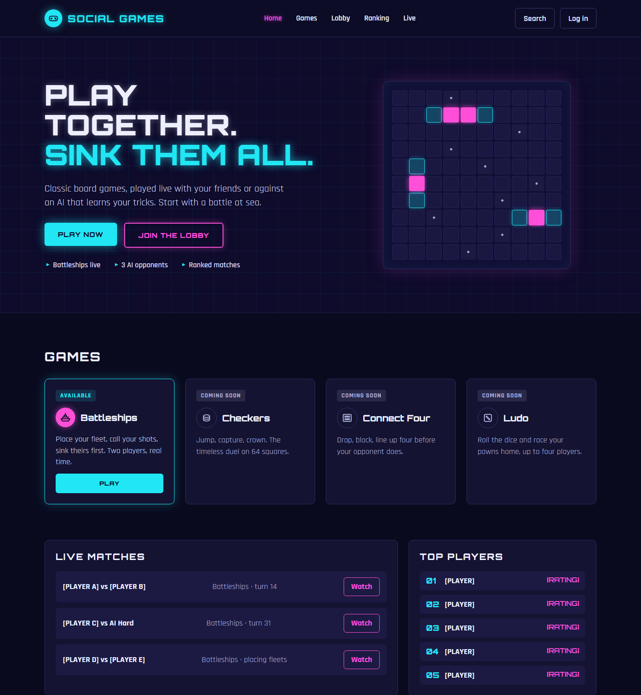
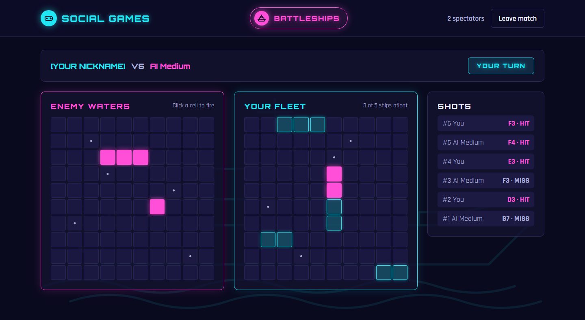

# SocialGamesPlatform

<a href="#english">🇬🇧 English</a> | <a href="#français">🇫🇷 Français</a>

---

## English

A platform for playing board games together online, built on .NET 10 LTS. The first game is Battleships.

> **Status:** project bootstrap. The scope and the roadmap are defined in [doc/analyse/roadmap.md](doc/analyse/roadmap.md); no game code yet.

### Preview

Design mock-ups of the arcade neon interface: they show the intended look, not the finished product.





### Requirements

| Tool     | Version                                                   |
|----------|-----------------------------------------------------------|
| .NET SDK | 10.0.403 or a later 10.0 feature band (see `global.json`) |
| IDE      | Visual Studio 2026 (`.slnx` solution format)              |
| Doxygen  | Optional, to generate the API documentation               |

### Getting started

```bash
git clone <repository-url>
dotnet build SocialGamesPlatform.slnx
```

### Repository layout

| Path                       | Purpose                                                       |
|----------------------------|---------------------------------------------------------------|
| `SocialGamesPlatform.slnx` | Solution file                                                 |
| `src/`                     | Source projects                                               |
| `test/`                    | Test projects                                                 |
| `doc/analyse/`             | Analysis: requirements, scope, architecture, decisions        |
| `doc/dev/`                 | Developer documentation (API reference generated by Doxygen)  |
| `doc/user/`                | User documentation                                            |
| `doc/adm/`                 | Administrator documentation: installation, configuration      |
| `Directory.Build.props`    | Shared build settings (target framework, nullable, analyzers) |
| `Directory.Packages.props` | Central NuGet package versions                                |
| `.editorconfig`            | Code style and analyzer rules, enforced at build time         |
| `Doxyfile`                 | Doxygen configuration for the API documentation               |

### Code quality

- Warnings are treated as errors: the build fails on any analyzer or style violation.
- [Roslynator](https://github.com/dotnet/roslynator) analyzers are applied to every project.
- Every public member must carry an XML documentation comment (`///`).

### Documentation

The API documentation is generated by [Doxygen](https://www.doxygen.nl) from the C# XML comments.

- **Doxywizard:** *File > Open* → `Doxyfile`, keep the working directory on the repository root, then *Run > Run doxygen*.
- **Command line:** `doxygen Doxyfile` from the repository root.

The output is written to `doc/dev/html/index.html` (not versioned).

### Conventions

- Code, comments, documentation and commit messages are written in English. Only this README is also available in French.
- Commit messages follow [Conventional Commits](https://www.conventionalcommits.org) (`feat:`, `fix:`, `docs:`, `chore:`…).
- Branching model, pull requests, versioning and releases: see [CONTRIBUTING.md](CONTRIBUTING.md). Changes are listed in [CHANGELOG.md](CHANGELOG.md).

### License

Licensed under the [PolyForm Strict License 1.0.0](LICENSE).

In short: you may use the software for noncommercial purposes only. Distributing it, modifying it or creating derivative works is not permitted. For any other use, contact the author. The [LICENSE](LICENSE) file is the only legally binding text.

### Author

Michaël Defraene

---

## Français

Une plateforme de jeux de société à jouer ensemble en ligne, en .NET 10 LTS. Le premier jeu est la bataille navale.

> **État :** démarrage du projet. Le périmètre et la roadmap sont définis dans [doc/analyse/roadmap.md](doc/analyse/roadmap.md) (en anglais) ; pas encore de code de jeu.

### Aperçu

Maquettes de l'interface en style arcade néon : elles montrent l'apparence visée, pas le produit fini.


### Prérequis

| Outil    | Version                                                                       |
|----------|-------------------------------------------------------------------------------|
| SDK .NET | 10.0.403 ou une bande de fonctionnalités 10.0 ultérieure (voir `global.json`) |
| IDE      | Visual Studio 2026 (format de solution `.slnx`)                               |
| Doxygen  | Facultatif, pour générer la documentation de l'API                            |

### Démarrage

```bash
git clone <url-du-depot>
dotnet build SocialGamesPlatform.slnx
```

### Organisation du dépôt

| Chemin                     | Rôle                                                                |
|----------------------------|---------------------------------------------------------------------|
| `SocialGamesPlatform.slnx` | Fichier de solution                                                 |
| `src/`                     | Projets sources                                                     |
| `test/`                    | Projets de tests                                                    |
| `doc/analyse/`             | Analyse : besoins, périmètre, architecture, décisions               |
| `doc/dev/`                 | Documentation développeur (référence de l'API générée par Doxygen)  |
| `doc/user/`                | Documentation utilisateur                                           |
| `doc/adm/`                 | Documentation administrateur : installation, configuration          |
| `Directory.Build.props`    | Paramètres de compilation communs (framework, nullable, analyseurs) |
| `Directory.Packages.props` | Versions NuGet centralisées                                         |
| `.editorconfig`            | Style de code et règles d'analyse, vérifiés à la compilation        |
| `Doxyfile`                 | Configuration Doxygen de la documentation de l'API                  |

### Qualité du code

- Les avertissements sont traités comme des erreurs : toute violation d'un analyseur ou du style fait échouer la compilation.
- Les analyseurs [Roslynator](https://github.com/dotnet/roslynator) s'appliquent à tous les projets.
- Chaque membre public doit porter un commentaire de documentation XML (`///`).

### Documentation

La documentation de l'API est générée par [Doxygen](https://www.doxygen.nl) à partir des commentaires XML C#.

- **Doxywizard :** *File > Open* → `Doxyfile`, garder le répertoire de travail sur la racine du dépôt, puis *Run > Run doxygen*.
- **Ligne de commande :** `doxygen Doxyfile` depuis la racine du dépôt.

Le résultat est écrit dans `doc/dev/html/index.html` (non versionné).

### Conventions

- Le code, les commentaires, la documentation et les messages de commit sont rédigés en anglais. Seul ce README existe aussi en français.
- Les messages de commit suivent [Conventional Commits](https://www.conventionalcommits.org/fr) (`feat:`, `fix:`, `docs:`, `chore:`…).
- Modèle de branches, pull requests, versions et releases : voir [CONTRIBUTING.md](CONTRIBUTING.md) (en anglais). Les changements sont listés dans [CHANGELOG.md](CHANGELOG.md).

### Licence

Distribué sous la [PolyForm Strict License 1.0.0](LICENSE).

En résumé : le logiciel peut être utilisé uniquement à des fins non commerciales. Sa distribution, sa modification et la création d'œuvres dérivées ne sont pas autorisées. Pour tout autre usage, contactez l'auteur. Seul le fichier [LICENSE](LICENSE), en anglais, fait foi.

### Auteur

Michaël Defraene
